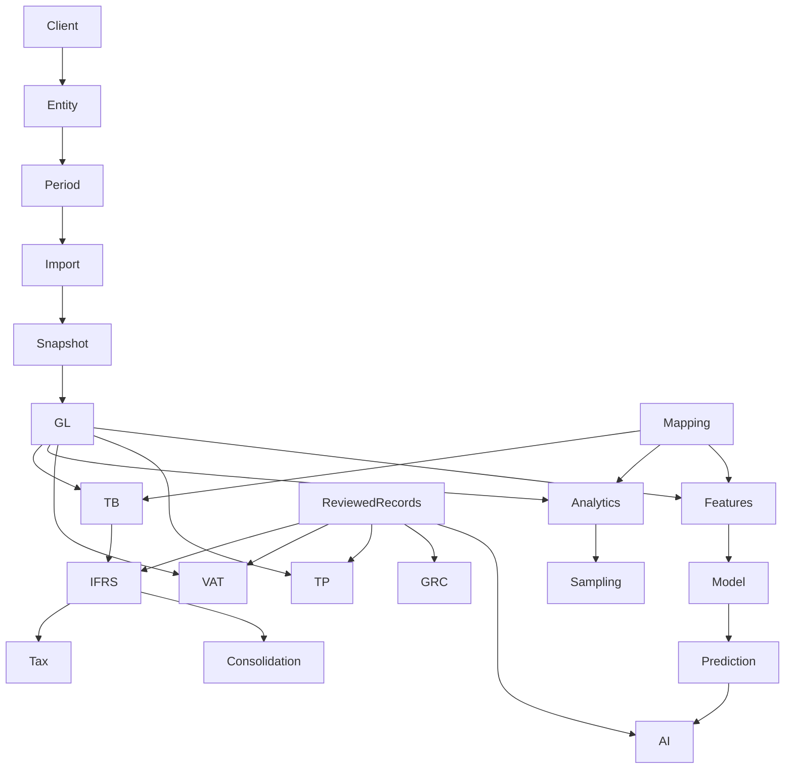

# Dependency graph

The graph represents dependency families, not evidence that every edge has a complete browser regression. Immutable calculation dependencies capture record id/version/status. ML datasets now capture active source snapshot hashes and chart mapping versions. The permission-filtered `GET /engagements/{eid}/audit/dependencies` registry verifies current receipts synchronously on every read with per-module paging. Source supersession and mapping changes never rewrite approved historical outputs.
